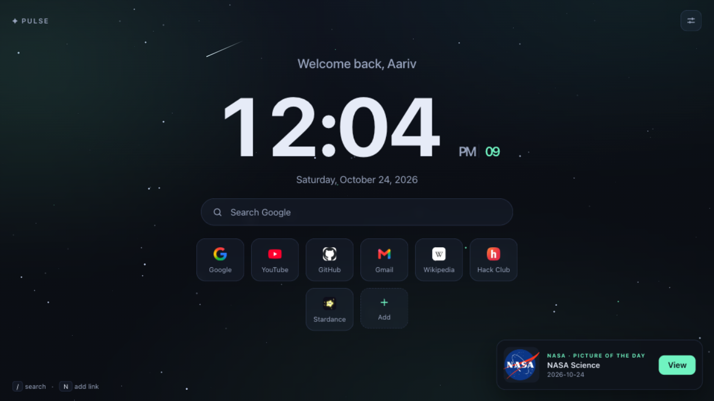

# Pulse - My Custom Browser New-Tab Dashboard

**Live Demo:** [https://aariv.me/pulse-new-tab/](https://aariv.me/pulse-new-tab/)



I built **Pulse** for the Hack Club Stardance **"Give Your Website a Pulse"** mission. It is the custom browser new-tab page I use every day: a large live clock, a time-of-day personal greeting, a keyboard-first search bar, an editable quick-links grid saved in `localStorage`, a live **NASA Astronomy Picture of the Day (APOD)** explorer, and a lightweight 60fps starfield background rendered on an HTML5 `<canvas>`.

---

## Why I Built This

I open a new browser tab well over a hundred times a day while switching between schoolwork, GitHub repos, and documentation. Most default new-tab pages are either blank or cluttered with sponsored news feeds, and heavy React extensions take a noticeable beat to hydrate every time you press `Cmd+T`.

When I tackled the Stardance "Give Your Website a Pulse" mission, I wanted to build a zero-dependency new-tab dashboard that loads in under 5 milliseconds from disk, lets me launch everything from the keyboard without touching the mouse, and pulls in NASA's Astronomy Picture of the Day with smart local caching so it still works when I am offline or when NASA's public API key hits rate limits.

---

## Features & How It Works Under the Hood

### 1. Live NASA APOD Integration with Offline Caching (`script.js`)
- **Real NASA API Fetch**: On load, Pulse requests today's astronomy entry from `https://api.nasa.gov/planetary/apod` and renders a preview card right on the dashboard.
- **Full-Resolution Inspector & Date Time-Machine**: Clicking **View** opens a modal with the complete astrophysics write-up by NASA astronomers, a link to the HD image, and a date picker (`1995-06-16` to today) so you can browse any past day's picture.
- **Image & Video Normalization**: NASA occasionally publishes video entries instead of photos. I wrote an embed normalizer that detects `media_type === "video"`, transforms `youtube.com/watch?v=`, `youtu.be/`, and `youtube.com/embed/` URLs into a clean responsive `<iframe>`, and renders direct video files inside an HTML5 `<video controls>` player.
- **Rate-Limit & Offline Resilience**: Because NASA's default `DEMO_KEY` is shared globally and often returns `HTTP 429 (OVER_RATE_LIMIT)` later in the afternoon, I built a two-layer fallback in `localStorage`. Every successful APOD payload is cached by date (`pulse_apod_cache_v1`), and if the network is offline or rate-limited, Pulse displays the last saved cosmos entry with a clear status badge and schedules an automatic background retry after 90 seconds (or immediately on the browser `online` event). You can also drop your own free key from [api.nasa.gov](https://api.nasa.gov) into `NASA_API_KEY` at the top of `script.js`.

### 2. Keyboard-First Navigation & Quick-Links Manager
- **Single-Key Shortcuts**:
  - `/` -> Immediately focuses the Google search bar from anywhere on the page
  - `N` -> Opens the **Add Quick Link** modal to pin a new site
  - `T` -> Toggles the main clock between **12-hour** (`AM/PM`) and **24-hour** military time (persisted in `localStorage`)
  - `Esc` -> Closes any open modal (Add Link or NASA APOD viewer)
- **Editable Quick-Links Grid**: Comes pre-seeded with my daily links (Google, YouTube, GitHub, Gmail, Wikipedia, Hack Club, Stardance). Every card has a remove (`x`) button, and new links added via the `N` shortcut automatically generate a clean initial badge and persist in `localStorage`.

### 3. Procedural Starfield Canvas ("The Pulse")
- Behind the glassmorphic UI cards, `<canvas id="pulse-canvas">` runs a lightweight `requestAnimationFrame` loop that renders drifting stars with sinusoidal alpha pulsing (`Math.sin(t * star.speed + star.phase)`), giving the page a calm nighttime atmosphere without spiking CPU usage.

---

## What Was Tricky to Build

1. **Handling Dead Fallback APIs & `HTTP 429` Gracefully**:
   Some older tutorials recommend `go-apod.herokuapp.com` as a backup when NASA's `DEMO_KEY` throttles, but when I tested it with `curl`, that Heroku app was completely gone (`404 Not Found` since Heroku retired free dynos). Instead of relying on a broken third-party proxy, I built exponential backoff (3 attempts) against `api.nasa.gov` paired with `localStorage` snapshot caching so the APOD card never breaks or leaves an empty box on the page.
2. **Preventing Keyboard Shortcuts from Hijacking Form Inputs**:
   When I first wired the `/` and `N` global `keydown` listeners, typing an `n` or `/` inside the search input or the "Add Link" URL field triggered the hotkeys. I added an active-element guard that checks `event.target.matches("input, textarea, select")` and ignores modifier keys (`metaKey`, `ctrlKey`, `altKey`) so global shortcuts only fire when you aren't typing in a field.

---

## How to Run It or Set It as Your New Tab

1. **Try it live**: Open [https://aariv.me/pulse-new-tab/](https://aariv.me/pulse-new-tab/).
2. **Run locally**: Clone this repository and open `index.html` directly in any browser, or run a local static server:
   ```bash
   python3 -m http.server 8080
   # Open http://localhost:8080
   ```
3. **Use as your browser startup / new-tab page**:
   - In Chrome / Brave / Arc: Go to **Settings -> On startup -> Open a specific page or set of pages** and add `https://aariv.me/pulse-new-tab/` (or your local `file://` path via a Custom New Tab URL extension).

---

## Project Files

- `index.html` - Semantic markup for the clock, greeting, search bar, quick-links grid, Add Link modal, and NASA APOD viewer dialog
- `style.css` - Dark glassmorphic styling, responsive grid layout, and modal transitions
- `script.js` - Clock ticker, keyboard shortcut router, `localStorage` quick-links CRUD, NASA APOD client with offline cache, and HTML5 canvas starfield
- `screenshot.png` - Full-window screenshot of Pulse running in the browser
- `BUILD-LOG.md` - Step-by-step development notes

## License

MIT.
